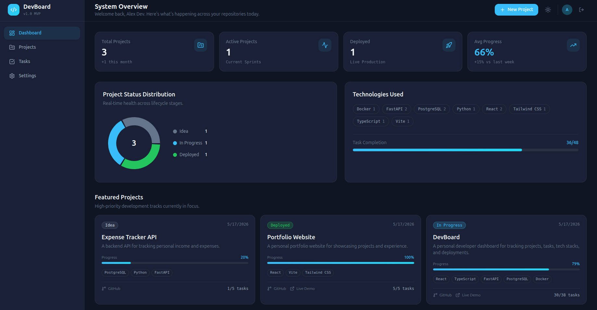
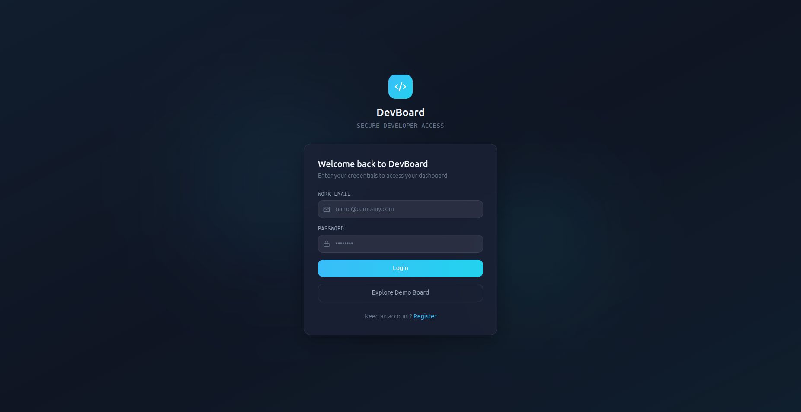
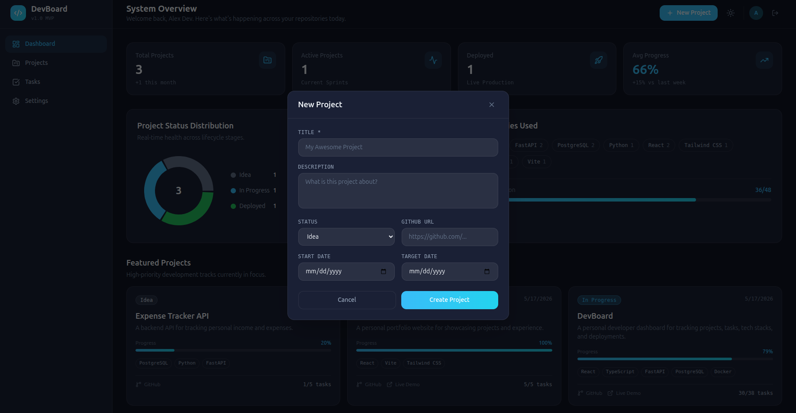
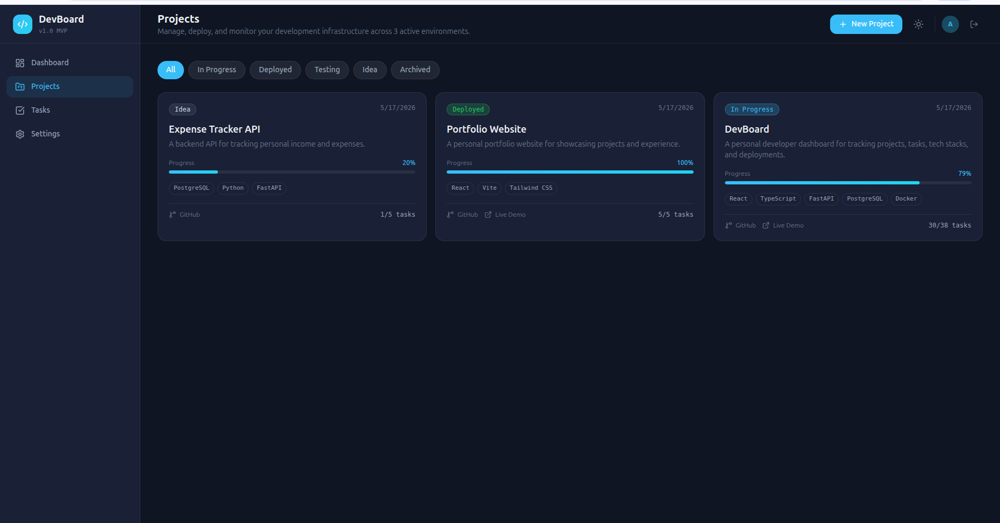
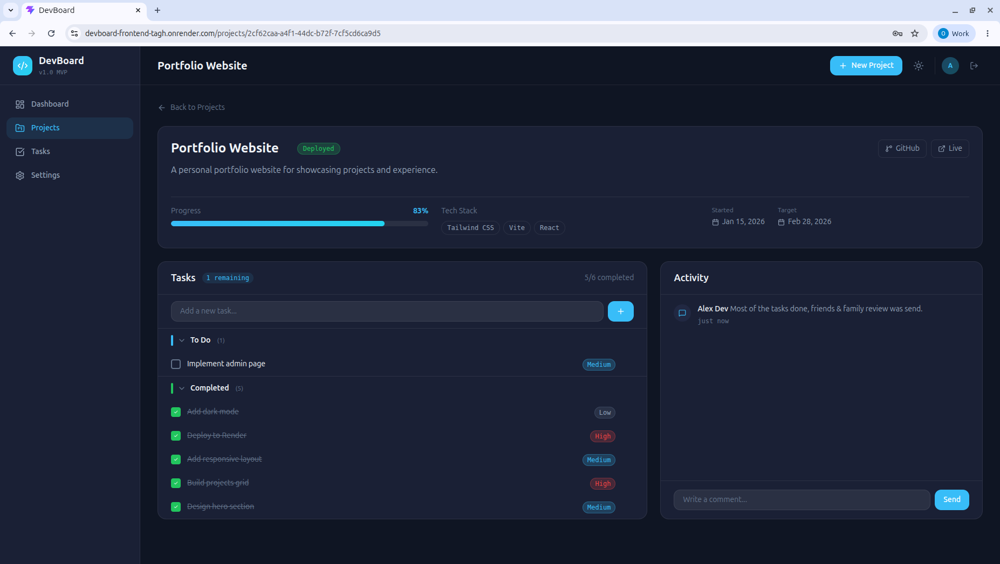
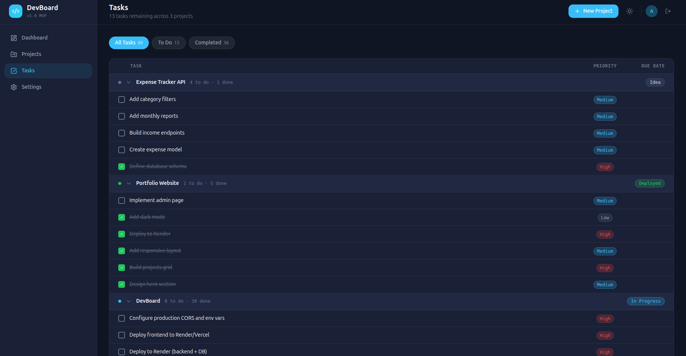
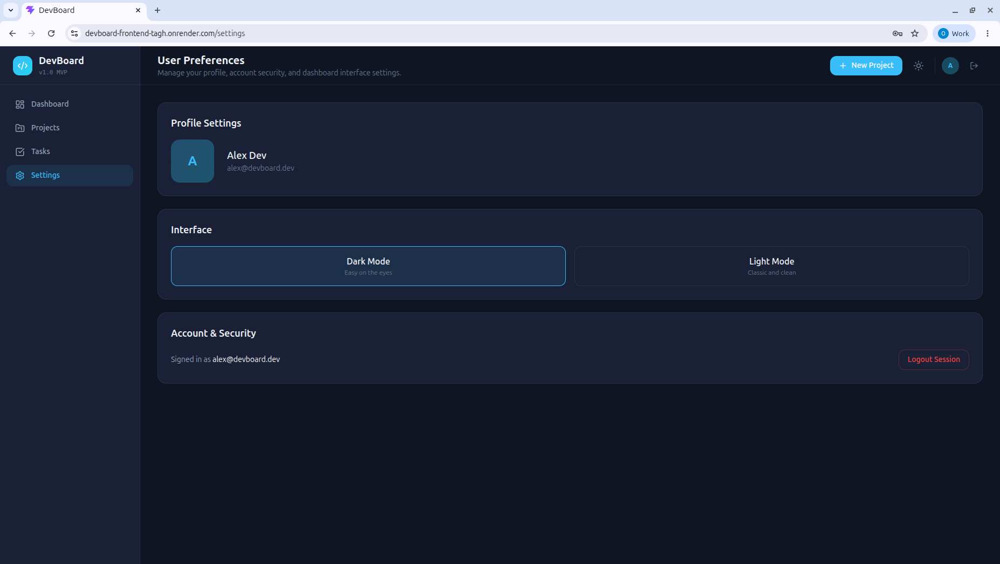
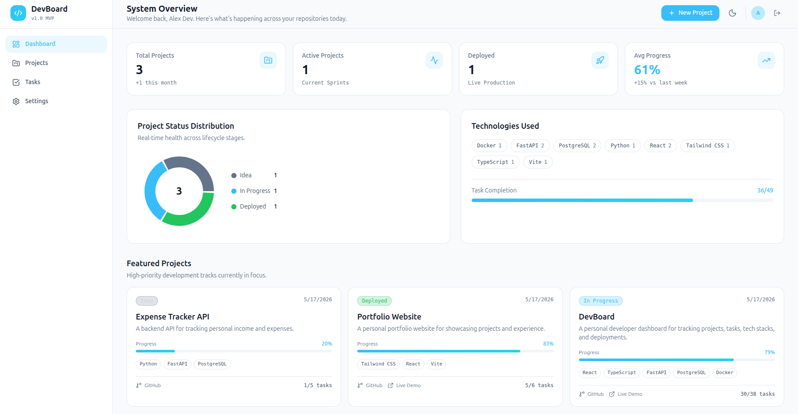

# DevBoard

A full-stack developer dashboard for tracking projects, tasks, and progress. Built with React, FastAPI, and PostgreSQL, orchestrated with Docker Compose.


**[Live Demo](https://devboard-frontend-tagh.onrender.com)** (hosted on Render's free tier, so it may take about 30 seconds to wake)



<details>
<summary>More screenshots</summary>

### Login / Register


### Creating a New Project


### Projects Tab


### Project's Details


### Tasks Tab


### Settings Tab


### Dashboard, Light Mode


</details>

## Features

- **Project Management:** Create, edit, and delete projects with status, progress tracking, and inline editing of titles, descriptions, and status badges
- **Task System:** Full task CRUD with priority levels (high/medium/low), due dates, completion tracking, and a cross-project tasks view
- **Task Detail View:** ClickUp-inspired task modal with inline-editable title, description, priority dropdown, and per-task comments
- **Tech Stack Tags:** Searchable technology picker per project; create new technologies inline and attach/detach with one click
- **Learning Notes:** Capture what you learned building each project, with topic tags and inline editing
- **Activity Feed:** Project-level comment threads with timestamped activity history
- **Dashboard:** Stat cards, clickable project-status donut chart, tech stack filters, and task completion metrics
- **Guest Demo Mode:** Fully interactive demo without an account: create, edit, and delete freely; nothing is persisted
- **JWT Authentication:** Login/register with bcrypt password hashing and per-IP rate limiting on auth endpoints
- **Dark/Light Theme:** Persistent theme toggle built on CSS custom properties (native widgets included via `color-scheme`)
- **Responsive & Accessible:** Mobile-friendly slide-out sidebar, keyboard-navigable controls with visible focus rings, labelled icon buttons

## Tech Stack

### Frontend
- React 19 + TypeScript
- Vite 8
- Tailwind CSS 4
- Framer Motion (animations)
- Recharts (dashboard charts)
- React Router v7
- Axios

### Backend
- FastAPI
- SQLAlchemy 2.0 (async-compatible ORM)
- Alembic (database migrations)
- PostgreSQL 16
- JWT authentication (python-jose + bcrypt)
- Pydantic v2 (validation)
- slowapi (rate limiting)

### Infrastructure
- Docker Compose for local development (frontend, backend, db and pgAdmin, with hot reload everywhere)
- Production: Render (static frontend + backend web service) with Neon serverless PostgreSQL

## Quick Start

### Prerequisites
- [Docker](https://docs.docker.com/get-docker/) and Docker Compose

### Setup

1. **Clone the repository**
   ```bash
   git clone https://github.com/OsherElikamel/devboard.git
   cd devboard
   ```

2. **Start all services**
   ```bash
   docker compose up --build
   ```

3. **Open the app** (migrations and seed data run automatically on first start)

   - Frontend: [http://localhost:5173](http://localhost:5173)
   - API docs: [http://localhost:8000/docs](http://localhost:8000/docs)
   - pgAdmin: [http://localhost:5050](http://localhost:5050) (admin@devboard.local / admin)

### Demo Login
- Click **"Explore Demo Board"** on the login page for instant access with pre-populated data
- In local development (`docker compose up`), a seeded account is also available: `alex@devboard.dev` / `demo1234` (seeding only runs when `SEED_DEMO_DATA=true`)

## Project Structure

```
devboard/
├── backend/
│   ├── alembic/              # Database migrations
│   ├── app/
│   │   ├── core/             # Config, security, dependencies
│   │   ├── db/               # Database connection, base class, seed
│   │   ├── models/           # SQLAlchemy models
│   │   ├── routers/          # API route handlers
│   │   ├── schemas/          # Pydantic request/response schemas
│   │   ├── services/         # Business logic layer
│   │   └── utils/            # Shared utilities
│   ├── Dockerfile
│   └── requirements.txt
├── frontend/
│   ├── src/
│   │   ├── components/       # Reusable UI components
│   │   │   ├── charts/       # DonutChart
│   │   │   ├── dashboard/    # StatCard
│   │   │   ├── layout/       # AppShell, Sidebar, Topbar
│   │   │   ├── projects/     # ProjectCard, CreateProjectModal, TechnologyPicker, LearningNotesPanel
│   │   │   ├── tasks/        # TaskDetailModal, PriorityDropdown
│   │   │   └── ui/           # Badge, ProgressBar, ThemeToggle
│   │   ├── contexts/         # Auth, Layout, Theme, Toast
│   │   ├── hooks/            # useDocumentTitle
│   │   ├── pages/            # Dashboard, Projects, Tasks, Settings, Admin
│   │   ├── routes/           # Route definitions + guards (code-split pages)
│   │   ├── services/         # Typed API layer + in-memory demo adapter
│   │   ├── types/            # TypeScript interfaces
│   │   └── utils/            # Shared formatting utilities
│   ├── Dockerfile
│   └── package.json
└── docker-compose.yml
```

## API Endpoints

### Auth
| Method | Endpoint | Description |
|--------|----------|-------------|
| POST | `/api/auth/register` | Create account |
| POST | `/api/auth/login` | Login (returns JWT) |
| GET | `/api/auth/me` | Get current user |

### Projects
| Method | Endpoint | Description |
|--------|----------|-------------|
| GET | `/api/projects` | List user projects |
| POST | `/api/projects` | Create project |
| GET | `/api/projects/:id` | Get project details |
| PATCH | `/api/projects/:id` | Update project |
| DELETE | `/api/projects/:id` | Soft-delete project |
| GET | `/api/projects/:id/activity` | Project activity feed |
| POST | `/api/projects/:id/comments` | Add project comment |
| GET | `/api/projects/:id/comments` | List project comments |

### Tasks & Comments
| Method | Endpoint | Description |
|--------|----------|-------------|
| GET | `/api/tasks` | List all tasks across the user's projects |
| GET | `/api/projects/:id/tasks` | List project tasks |
| POST | `/api/projects/:id/tasks` | Create task |
| PATCH | `/api/tasks/:id` | Update task |
| DELETE | `/api/tasks/:id` | Delete task |
| GET | `/api/tasks/:id/comments` | List task comments |
| POST | `/api/tasks/:id/comments` | Add task comment |
| DELETE | `/api/comments/:id` | Delete comment |

### Technologies
| Method | Endpoint | Description |
|--------|----------|-------------|
| GET | `/api/technologies` | List all technologies |
| POST | `/api/technologies` | Create technology |
| POST | `/api/projects/:id/technologies` | Attach technologies to project |
| DELETE | `/api/projects/:id/technologies/:tid` | Detach technology |

### Learning Notes
| Method | Endpoint | Description |
|--------|----------|-------------|
| GET | `/api/projects/:id/learning-notes` | List project notes |
| POST | `/api/projects/:id/learning-notes` | Create note |
| PATCH | `/api/learning-notes/:id` | Update note |
| DELETE | `/api/learning-notes/:id` | Delete note |

### Dashboard & Admin
| Method | Endpoint | Description |
|--------|----------|-------------|
| GET | `/api/dashboard/summary` | Dashboard stats |
| GET | `/api/health` | Health check |
| GET | `/api/admin/stats` | Admin statistics |
| GET | `/api/admin/users` | List all users |
| DELETE | `/api/admin/users/:id` | Delete user |
| GET | `/api/admin/projects` | List all projects |
| DELETE | `/api/admin/projects/:id` | Delete project |

### Demo (Guest Mode)
| Method | Endpoint | Description |
|--------|----------|-------------|
| GET | `/api/demo/dashboard` | Demo dashboard data |
| GET | `/api/demo/projects` | Demo project list |
| GET | `/api/demo/projects/:id` | Demo project detail |
| GET | `/api/demo/projects/:id/tasks` | Demo project tasks |
| GET | `/api/demo/projects/:id/activity` | Demo project activity |
| GET | `/api/demo/projects/:id/learning-notes` | Demo learning notes |
| GET | `/api/demo/tasks/:id/comments` | Demo task comments |

## Environment Variables

### Backend (`backend/.env.example`)
| Variable | Description | Default |
|----------|-------------|---------|
| `DATABASE_URL` | PostgreSQL connection string | `postgresql+psycopg://devboard_user:devboard_password@db:5432/devboard_db` |
| `JWT_SECRET_KEY` | Secret for signing JWT tokens | `change_me_in_production` |
| `JWT_ALGORITHM` | JWT signing algorithm | `HS256` |
| `ACCESS_TOKEN_EXPIRE_MINUTES` | Token expiry time | `60` |
| `BACKEND_CORS_ORIGINS` | Allowed CORS origins (JSON array) | `["http://localhost:5173"]` |
| `ADMIN_EMAIL` | Email of the admin user (enables `/api/admin` endpoints) | _(none)_ |
| `SEED_DEMO_DATA` | Seed demo user/projects on startup (dev only, never enable in production) | `false` |
| `RATE_LIMIT_ENABLED` | Per-IP rate limiting on auth endpoints (login 5/min, register 20/hour) | `true` |

### Frontend (`frontend/.env.example`)
| Variable | Description | Default |
|----------|-------------|---------|
| `VITE_API_BASE_URL` | Backend API base URL | `http://localhost:8000/api` |

## Deployment

The live instance runs on free tiers:

- **Frontend:** Render static site built from `frontend/` (`npm run build`, publish `dist/`), with a rewrite rule sending all paths to `/index.html` for SPA routing
- **Backend:** Render web service running `alembic upgrade head && python -m app.db.seed && uvicorn app.main:app --host 0.0.0.0 --port $PORT` (migrations run on every deploy; seeding is a no-op unless `SEED_DEMO_DATA=true`)
- **Database:** [Neon](https://neon.tech) serverless PostgreSQL (the config layer normalizes `postgres://` URLs to the `psycopg` driver automatically)

Backend env vars on Render: everything from the table above, plus `FORWARDED_ALLOW_IPS=*` so uvicorn trusts Render's proxy headers and rate limiting sees real client IPs.

## License

MIT
